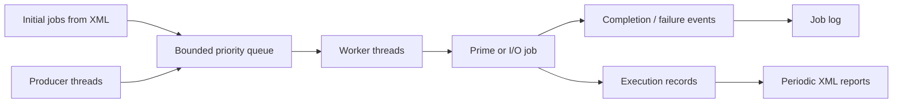

# Industrial Processing System

A C# console application developed for the **Supervisory Control Systems Software** course at the Faculty of Technical Sciences, University of Novi Sad.

The project simulates an industrial job processing service with **concurrent producers and workers**, a **bounded priority queue**, asynchronous job results, retry handling, event-based logging, and periodic XML reports. Its focus is thread synchronization and reliable coordination of concurrent tasks.

## Features

- **Concurrent job submission:** multiple producer threads generate jobs while worker threads process them.
- **Priority-based scheduling:** jobs are dequeued by priority, with lower numbers representing higher priority.
- **Bounded queue:** new jobs are rejected when the configured waiting queue is full.
- **Asynchronous results:** `Submit(Job)` returns a `JobHandle` containing a `Task<int>` for the result.
- **Idempotent submission:** submitting the same job ID more than once returns the existing handle instead of scheduling a duplicate.
- **Timeouts and retries:** jobs that exceed two seconds are reported as failed; up to three attempts are made before an `ABORT` result.
- **Event-driven logging:** completion and failure events trigger serialized asynchronous writes to a log file.
- **Periodic reporting:** LINQ-based summaries are written to XML every minute, retaining the ten most recent reports.
- **XML configuration:** worker count, queue capacity, and initial jobs are loaded when the application starts.

## How it works



Workers take the highest-priority **waiting** job available. Already running jobs are not preempted when a higher-priority job arrives.

### Job types

| Type | Operation | Example payload |
| --- | --- | --- |
| `Prime` | Counts prime numbers up to a specified limit, dividing the calculation among 1–8 threads. | `numbers:10_000,threads:3` |
| `IO` | Simulates a delayed I/O operation and returns a random value from 0 to 100. | `delay:1_000` |

The application also exposes `GetTopJobs(n)` for inspecting the highest-priority queued jobs and `GetJob(id)` for retrieving a previously submitted job.

## Screenshots

The following screenshots show the console application during execution, including its job processing output.


## Technologies and concepts

- **C# / .NET 10**
- `Thread`, `Task`, `SemaphoreSlim`, and `lock`
- `TaskCompletionSource<int>` for asynchronous results
- Events and delegates for completion and failure notifications
- LINQ for reporting
- XML configuration and report generation

## Running the project

**Requirements:** .NET 10 SDK.

Clone the repository and, from its root directory, run:

```bash
git clone https://github.com/nikolasa004/SNUS-IndustrialProcessingSystem.git
cd SNUS-IndustrialProcessingSystem
dotnet run --project IndustrialProcessingSystem/IndustrialProcessingSystem/IndustrialProcessingSystem.csproj
```

The application loads `SystemConfig.xml`, submits the initial jobs, and starts producer and worker threads. While it is running:

- Press **Enter** to display up to five waiting jobs in priority order.
- Type **`q`** and press **Enter** to stop the producers and worker threads.
- Leave it running for at least one minute to generate an XML report.

You can also open `IndustrialProcessingSystem/IndustrialProcessingSystem.slnx` in a compatible Visual Studio version.

## Configuration

The project includes [`SystemConfig.xml`](IndustrialProcessingSystem/IndustrialProcessingSystem/SystemConfig.xml) with a sample configuration:

```xml
<SystemConfig>
    <WorkerCount>5</WorkerCount>
    <MaxQueueSize>100</MaxQueueSize>
    <Jobs>
        <Job Type="Prime" Payload="numbers:10_000,threads:3" Priority="1" />
        <Job Type="Prime" Payload="numbers:20_000,threads:2" Priority="2" />
        <Job Type="IO" Payload="delay:1_000" Priority="3" />
        <Job Type="IO" Payload="delay:3_000" Priority="3" />
        <Job Type="IO" Payload="delay:15_000" Priority="3" />
    </Jobs>
</SystemConfig>
```

`WorkerCount` controls the number of worker threads and producer threads started by the demo. `MaxQueueSize` limits the number of jobs **waiting in the queue**, not jobs already being executed. Each initial job specifies its type, payload, and priority.

The XML file is copied into the build output directory automatically, where the executable reads it on startup.

## Logs and reports

- **`job_log.txt`** records job completion and failure events, including the job ID, result, attempt number, and elapsed time. It is written to the executable's output directory (typically `bin/Debug/net10.0/`).
- **`Reports/report_*.xml`** contains periodic summaries of completed jobs by type, average successful execution time by type, and failed jobs by type. The `Reports` folder is created relative to the process's working directory.
- At most **10 XML reports** are kept; subsequent reports replace the oldest file.

Both generated outputs are excluded from Git through `.gitignore`.

## Project structure

```text
.
├── IndustrialProcessingSystem/
│   ├── IndustrialProcessingSystem.slnx
│   └── IndustrialProcessingSystem/
│       ├── ProcessingSystem.cs     # Priority queue, workers, retries, reporting
│       ├── Program.cs              # Producers, console interaction, event handlers
│       ├── SystemConfig.cs         # XML configuration loader
│       ├── SystemConfig.xml        # Sample configuration
│       ├── Job.cs                  # Job model
│       ├── JobHandle.cs            # Asynchronous result handle
│       ├── JobEventArgs.cs         # Event payload
│       ├── JobType.cs              # Supported job types
│       └── IndustrialProcessingSystem.csproj
├── docs/
│   └── images/                    # Console screenshots
│       ├── Screenshot 2026-10-27 132714.png
│       └── Screenshot 2026-10-27 132738.png
├── .gitignore
└── README.md
```
